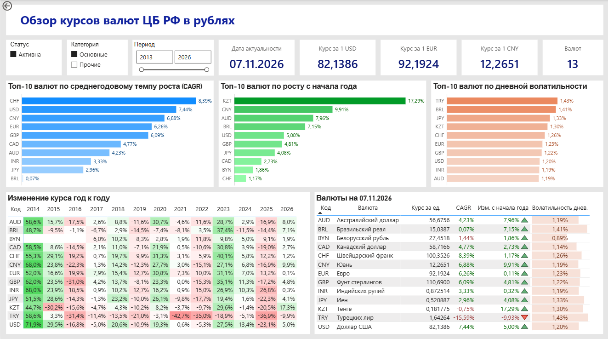
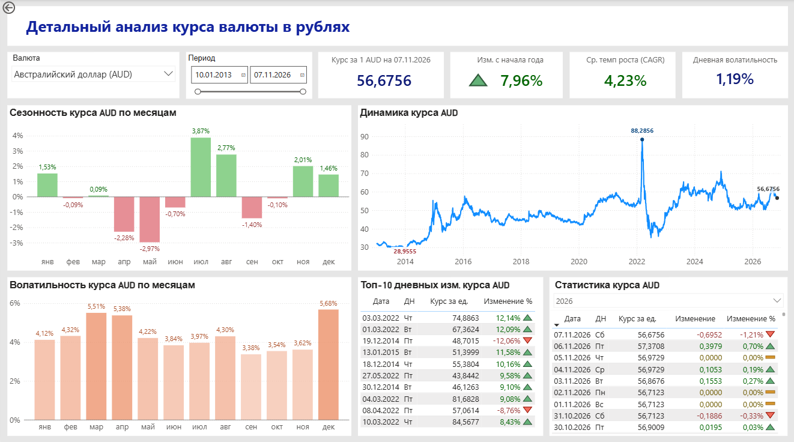

# Аналитика курсов валют ЦБ РФ (Power BI)
[project](https://github.com/ghdena/Portfolio/blob/main/CBR_rates_Power_BI/CBR_currency_rates.pbix)

Проект сквозной аналитики (End-to-End), посвященный анализу официальных курсов валют, устанавливаемых Центральным банком РФ. В проекте реализован ETL-процесс в Power Query, построена модель данных «Звезда» и написаны меры на языке DAX для расчета финансовых метрик.

> **Примечание:** Этот проект является обновленной версией [предыдущей работы](https://github.com/ghdena/Portfolio/tree/main/CBR_currency). Источник данных был изменен с живой базы данных PostgreSQL на CSV-файл, размещенный в репозитории. Это сделало файл `.pbix` полностью автономным и доступным для просмотра без развертывания БД.

### Цель проекта
Создать интерактивный дашборд для отслеживания динамики курсов, оценки рисков (волатильности) и выявления сезонных закономерностей на валютном рынке РФ.

### Превью дашбордов

#### 1. Обзор рынка
*Топ валют по среднегодовому темпу роста (CAGR), росту с начала года и дневной волатильности. Тепловая карта изменения курса год к году.*

#### 2. Детальный анализ валюты
*Анализ выбранной валюты: историческая динамика, сезонность по месяцам, среднемесячная волатильность и топ-10 аномальных дней.*

### Технологии и архитектура
*   **Источник данных:** CSV-файл в репозитории (выгружен из БД PostgreSQL, источник — API ЦБ РФ).
*   **ETL (Очистка и трансформация):** Power Query (язык M).
*   **Модель данных:** Схема «Звезда» (Факты + Справочник Валют + Календарь).
*   **Аналитика:** DAX (Data Analysis Expressions).
*   **Визуализация:** Power BI Desktop.

### Как открыть проект
1. Скачайте файл `.pbix` из папки проекта.
2. Откройте файл с помощью **Power BI Desktop**.
3. Данные подтягиваются автоматически по прямой ссылке на CSV-файл из этого репозитория (через `Web.Contents`).
4. Нажмите **«Обновить»** (Refresh), чтобы загрузить данные.

### Лицензия
Проект распространяется под лицензией MIT. Подробности в файле [LICENSE](https://github.com/ghdena/Portfolio/refs/heads/main/CBR_rates_Power_BI/LICENSE).
